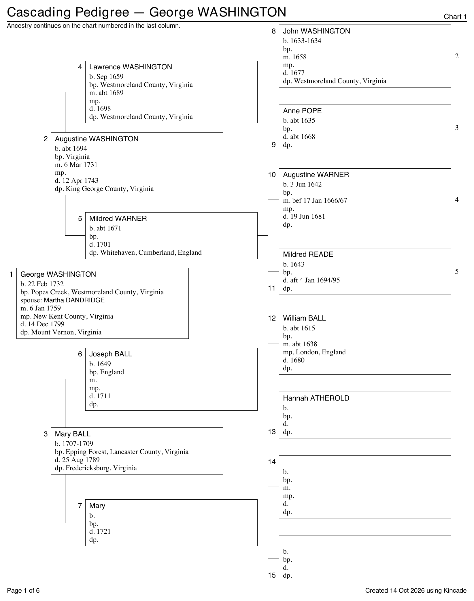
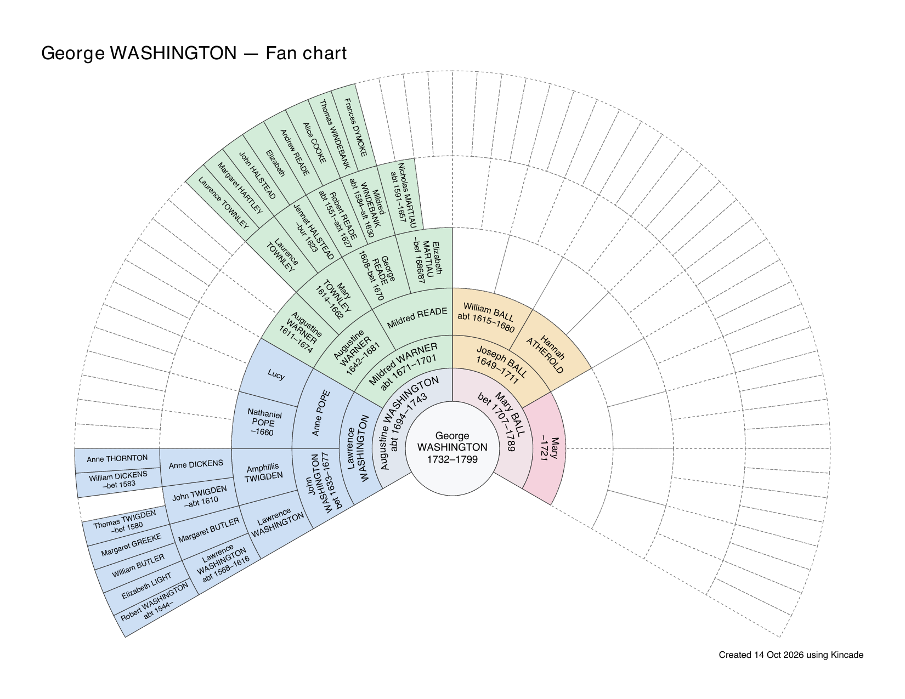

# Kincade

Kincade turns GEDCOM files into printable ancestor charts: cascading pedigrees
that continue across pages, or fan charts on a single page. Use it in your browser,
from the command line, or from Python.

[Try Kincade in your browser](https://ttop.github.io/kincade/).

<table>
  <tr>
    <th>Cascading pedigree</th>
    <th>Fan chart</th>
  </tr>
  <tr>
    <td width="50%" valign="top">
      <a href="docs/examples/cascading-pedigree.pdf">
        
      </a>
    </td>
    <td width="50%" valign="top">
      <a href="docs/examples/fan-chart.pdf">
        
      </a>
    </td>
  </tr>
</table>

## In the browser

Open [Kincade](https://ttop.github.io/kincade/) and choose **See an example**, or
open your own GEDCOM file. Choose a person and chart type, adjust the options,
and download the PDF. Your family data stays in your browser.

For pedigrees, people with multiple marriages have a **Root marriage** dropdown
below their name so you can choose which spouse and marriage to show.

The page is in English, German, Spanish, French or Italian. It opens in your
browser's language when it has it, and the language menu at the top changes it.
Charts are made in the page's language; **Chart language** under **More options**
makes them in another. A link can choose the language, such as
`https://ttop.github.io/kincade/?lang=fr`.

The page needs an internet connection to load. The first visit downloads about
11 MB; later visits can reuse the browser's cache.

## Quick start

You need [uv](https://docs.astral.sh/uv/) and Git. Kincade requires Python 3.11 or
later; uv can download Python and install the dependencies for you.

Download Kincade and open its folder:

```sh
git clone https://github.com/ttop/kincade
cd kincade
```

### Use your browser locally

From the Kincade folder, build the browser page and start a local web server:

```sh
uv run python web/build.py
uv run python -m http.server -d web/site 8000
```

Open [http://localhost:8000/](http://localhost:8000/) and choose **See an example**,
or open your own GEDCOM file. Leave the server running while using the page;
press Ctrl+C in the terminal when finished.

An internet connection is needed to load the page's dependencies. Your family
data stays in your browser.

See [Building and hosting the browser page](web/README.md) for more details.

### Use the command line

Find George Washington in [the example GEDCOM](docs/examples/george-washington.ged):

```console
$ uv run kincade docs/examples/george-washington.ged --find "George Washington"
I1	George WASHINGTON	1732-1799
    F1	Martha DANDRIDGE	m. 6 Jan 1759	mp. New Kent County, Virginia	(default)
```

The person's row lists their record ID, name, and life years. `I1` is George
Washington's record ID; `1732-1799` gives his birth and death years. Indented rows
list spouse families and their marriage details; `(default)` marks the family
used for the root box unless you select another.

`--root` accepts either a name or a record ID for either chart type:

```sh
uv run kincade docs/examples/george-washington.ged --root "George Washington" -o pedigree.pdf
uv run kincade docs/examples/george-washington.ged --root I1 --fan --generations 7 -o fan.pdf
```

These create the charts shown in the preview above. 
A record ID avoids ambiguity between people with similar names.

For your own GEDCOM file, replace `docs/examples/george-washington.ged` with its
path. Search for a person, then use their name or record ID from the results
with `--root`.


### Installation

To run Kincade from any folder, install it as a tool:

```sh
uv tool install git+https://github.com/ttop/kincade
```

After installation, you may use `kincade` directly without calling `uv`. For example, from the `kincade`
folder:

```sh
kincade docs/examples/george-washington.ged --root "George Washington" -o pedigree.pdf
```

You can also install with `pip install git+https://github.com/ttop/kincade` in your Python environment.


## Using Kincade

- [Cascading pedigrees](#cascading-pedigree), [fan charts](#fan-chart) and
  [blank charts](#blank-chart)
- [Command options](#options) and [config files](#config-file)
- [Privacy](#privacy), [languages](#language-translations) and [index sorting](#index-sort-order)
- [GEDCOM input](#input-files)
- [Python library](docs/library.md)

## Cascading pedigree

A pedigree starts with the root person and their ancestors. Older generations
continue on additional charts, linked by chart numbers. A name index helps you
find each person's chart and box.

```sh
uv run kincade docs/examples/george-washington.ged --root "George Washington" --generations 7 -o pedigree.pdf
```

The generation count begins with the root person. By default, Kincade includes all
ancestor generations of the root person unless `--generations` is provided.

The root box includes the spouse's name and marriage details. To choose a
marriage, use `--find` to see the spouse families and their record IDs:

```console
$ uv run kincade docs/examples/george-washington.ged --find "Augustine Washington"
I2	Augustine WASHINGTON	1694-1743
    F25	Jane BUTLER	m. 20 Apr 1715	(default)
    F2	Mary BALL	m. 6 Mar 1731
```

`(default)` marks the first spouse family recorded for Augustine: `F25`, his
marriage to Jane Butler. Use `--root-family F2` to show Mary Ball and their 1731
marriage in the root box instead:

```sh
uv run kincade docs/examples/george-washington.ged --root I2 --root-family F2 -o augustine.pdf
```

In the browser, use **Root marriage** under **More options** to make the same choice.

Use `--large-print` for larger text and fewer generations per page.

Long place names are shortened to fit their boxes. `--no-shorten-places` preserves
more of the original wording, truncating the end when it cannot fit.

## Fan chart

`--fan` draws a single landscape page with the root person in the center and a
ring for each generation of ancestors. Four colors distinguish the grandparent
lines. 


```sh
uv run kincade docs/examples/george-washington.ged --root I1 --fan --generations 7 -o fan.pdf
uv run kincade docs/examples/george-washington.ged --root "George Washington" --fan --generations 7 --ink grayscale --paper a3 -o fan-a3.pdf
```

A fan chart supports up to 7 generations, including the root person; the default is 6. Fewer
generations result in larger text. Use `--ink grayscale` for gray fills or `--ink bw`
for outlines without fills. Fan charts support Letter, A4, Tabloid and A3 paper.

Cells show names and life years. An ancestor appearing in several branches is
marked with their repeat count, such as `×2`. Long names are shortened to fit.

## Blank chart

You can make a blank pedigree sheet:

```sh
uv run kincade --blank -o blank.pdf
uv run kincade --blank --large-print --paper a4 --lang de -o blank-de.pdf
```

[View the example blank chart](docs/examples/blank-chart.pdf).


## Options

Kincade's help lists every option with a short explanation:

```console
$ uv run kincade --help
usage: kincade FILE.ged --root PERSON [options]
       kincade FILE.ged --root PERSON --fan [options]
       kincade FILE.ged --find TEXT [options]
       kincade --blank [options]
       kincade --show-config [options]

Make a cascading pedigree PDF from a GEDCOM file: chart 1 for the root person,
a further chart wherever a line runs past the last column, and a name index at
the end.
With --fan, make a fan chart on one landscape page.

options:
  -h, --help           show this help message and exit

person:
  FILE.ged             GEDCOM file to read
  --root PERSON        person at the head of chart 1: a record ID (I12) or
                       part of a name
  --root-family FAMILY
                       family record ID for the root's spouse and marriage
                       (default: first spouse family; pedigree only)
  --find TEXT          list matching people and their spouse families;
                       (default) marks the first spouse family

content:
  --fan                draw the fan chart (one page, up to 7 generations)
                       instead of the pedigree
  --generations N      show N generations, counting the root as 1 (default:
                       all; with --fan, 2 to 7, default 6)
  --exclude-private    hide the names and details of people who may be living
  --preserve-case      keep recorded surname case in charts and selection
                       lists
  --adoptive-parents   where a person has adoptive or foster parents, draw
                       those instead of birth parents; on the pedigree a note
                       follows the name
  --no-event-standins  show only births and deaths; privacy still uses
                       christenings, baptisms, burials and cremations
  --no-empty           leave out the boxes of unknown ancestors (pedigree
                       only)
  --show-ids           show each person's record ID beside their name, on the
                       charts and in the index (pedigree only)
  --no-shorten-places  cut a long place with "…" instead of first leaving out
                       its country and middle parts (pedigree only)
  --no-index           leave out the name index page(s) at the end (pedigree
                       only)

page:
  -o, --output FILE    PDF to write (default: named in the chart language, in
                       English "<root name> cascading pedigree.pdf"; with
                       --fan: "<root name> fan chart.pdf"; with --blank:
                       "Blank cascading pedigree.pdf")
  --paper {letter,a4,tabloid,a3}
                       paper size (default: letter); tabloid and a3 are for
                       the fan chart
  --ink {color,grayscale,bw}
                       ink for the fan chart (default: color; fan chart only)
  --large-print        use larger print and three generations per page
                       (pedigree only)
  --shadow             draw a drop shadow under each box (pedigree only)
  --lang LANG          language name (such as de) or .toml path; user files:
                       ~/.config/kincade/lang/ (default: English)
  --title TEXT         page title (default: chart title and root's name)
  --footer TEXT        footer text (default: the language's footer)
  --no-footer          leave out the footer
  --no-page-numbers    leave out the page numbers (pedigree only)
  --blank              make one blank chart to fill in by hand (no GEDCOM
                       file) (pedigree only)

config file:
  --config FILE        read config file FILE instead of ./kincade.toml or
                       ~/.config/kincade/config.toml
  --no-config          don't read a config file
  --show-config        print the config in use and where each value came from

Example:
  uv run kincade docs/examples/george-washington.ged \
    --root "George Washington"

Exit codes:
  0: success (PDF, --find, --show-config or --help)
  1: a file cannot be read or written, a GEDCOM file has no people, a language
     cannot be used, or no match for --root or --find
  2: a usage error, an ambiguous --root or an invalid config file
```

Use options to change the paper, generation count, language, title, footer and
other chart settings. The help marks options that apply to only one chart type.
Use `-o` to choose where to save the PDF; otherwise Kincade names it after the
root person and saves it in the current folder. Automatic filenames preserve the
recorded name spelling, regardless of `--preserve-case`, for both pedigree and fan
charts. Chart text, the default fan title and PDF metadata still use uppercase
surnames by default. An output path supplied with `-o` or in the config file is
used as written.

## Config file

Save your usual settings in `kincade.toml` in the folder where you run the command,
or in `~/.config/kincade/config.toml`. The local file takes precedence; the files
are not combined. Use `--config FILE` to choose another file or `--no-config` to
ignore them.

Start with [kincade.example.toml](kincade.example.toml):

```toml
gedcom = "family.ged"
root = "@I12@"
generations = 7
lang = "de"
exclude_private = true
paper = "a4"
```

The GEDCOM path in the config file is relative to that file's folder. Output and
language-file paths are relative to the folder where you run Kincade. `~` expands
to your home folder. Command-line options override config values; unspecified
settings use their defaults.

Keys use option names with underscores: `exclude_private = true` means
`--exclude-private`, and `no_index = true` means `--no-index`. 
`--find` and `--blank` have no config keys. 

```sh
uv run kincade --show-config
```

This prints the effective settings as TOML, with the source of each value.

## Privacy

Use `--exclude-private` to replace possibly living people's names with `Living`
and hide their dates, places, relationship notes and record IDs in the PDF. They
retain their positions in the chart but are omitted from the name index. Marriage
details are hidden if either spouse may be living.

```sh
uv run kincade family.ged --root I12 --exclude-private -o private.pdf
```

Generated filenames, the default fan title and PDF metadata also conceal the
root's name when they may be living. A title or filename you supply is used as
written. The label is translated when you select another language.

With privacy enabled, command-line search results and ambiguous-root lists
conceal names and years but keep record IDs so you can choose a person. The
browser's local person picker keeps names for selection and conceals the years.

Kincade estimates living status from the available records. A person is treated
as possibly living unless they have a death, burial or cremation record, or their
latest possible birth year is at least 100 years ago. Missing or uncertain dates
can therefore keep someone private. 

Birth estimates can use birth, christening, baptism or descendant records.
Uncertain dates are treated conservatively. Disabling event stand-ins changes
what is displayed but does not change the privacy estimate.
[The design notes](docs/design.md#the-privacy-estimate) describe the rules in detail.

## Language Translations

English, German, Spanish, French and Italian are included, named by their ISO
639-1 codes: `--lang de`, `es`, `fr` or `it`. You can also supply your own wording
in a TOML language file:

```sh
uv run kincade family.ged --root I12 --lang fr -o pedigree-fr.pdf
uv run kincade family.ged --root I12 --lang ~/my-wording.toml
```

| Language | `--lang` | Pedigree title | Box labels |
|---|---|---|---|
| English | `en` | Cascading Pedigree | b. bp. m. mp. d. dp. |
| German | `de` | Ahnentafel | geb. verh. gest., in … |
| Spanish | `es` | Árbol de antepasados | n. matr. f., en … |
| French | `fr` | Arbre d’ascendance | naiss. mar. déc., à … |
| Italian | `it` | Albero degli antenati | n. matr. m., a … |

For additional language support, copy [the English template](kincade/lang/en.toml) and 
translate its values. The [German](kincade/lang/de.toml), [Spanish](kincade/lang/es.toml),
[French](kincade/lang/fr.toml) and [Italian](kincade/lang/it.toml) files are other
examples. Omitted values keep their English wording. 

A language name is looked up in
the package's language folder, then in `~/.config/kincade/lang/`. PDF labels,
dates, titles, footers and the saved PDF's name are translated. `--title`,
`--footer` and `-o` override the language defaults.


## Index sort order

The pedigree index sorts by surname, given name, birth year and suffix. Missing
or placeholder surnames sort last. Printed names keep their accents; sorting
does not change their displayed spelling.

The default folds accents to their base letters, ignores punctuation and reads a
hyphen as a space, so hyphenated names file word by word. A language file's
`[sort]` table can change the order:

| Setting | Example |
|---|---|
| `expand` | `"ü" = "ue"` sorts Müller with Mueller. |
| `after_z` | `["å", "ä", "ö"]` places these letters after Z, in that order. |
| `ignore_particles` | `["von", "der"]` files von der Heide under H; `["d’"]` files d’Artagnan under A; `["de la"]` files de la Fuente under F. The skipped particles print in recorded case (Anna von der HEIDE) and, in the index, after the given name (HEIDE, Anna von der). |
| `surname_start` | `mc = "mac"` files McClure with MacClure. The 1.0 setting `mc_as_mac = true` reads as this. |

The same table's `keep_case_prefixes` lists the prefixes that keep their case when a
surname prints in capitals, if a capital follows them: the default `["Mc"]` prints
McClure as McCLURE, and adding `"Mac"` prints MacDonald as MacDONALD but Macy as MACY.


The [English template](kincade/lang/en.toml) documents every key. Each bundled
language file sets its language's order: German follows DIN 5007-2, Spanish files ñ
after n and skips de, del and de la, French skips de and d’ and sorts œ as oe, and
Italian keeps particles as part of the surname.


## Input Files

Kincade reads GEDCOM 5.5, 5.5.1 and 7.0 files. 

Both chart types, the pedigree name index, and `--find` results uppercase
surnames, keeping the case of the language's skipped particles and
`keep_case_prefixes`, as in `Anna von der HEIDE` and `McCLURE`. Use `--preserve-case` to keep
the recorded surname case instead.

Dates are formatted for the selected language. Unrecognized date text is
preserved rather than stopping the import. GEDCOM 7 date phrases are supported.
Years need three or four digits, and days must be 1 to 31. Dates in unsupported
calendars remain as written; see [Privacy](#privacy) for how uncertain dates
affect living status.

A christening or baptism can stand in for birth, and a burial or cremation for
death; if those dates are unavailable. These are labeled accordingly. 
Use `--no-event-standins` to disable them. Marriages come from family records, not 
marriage events on an individual.


### Parents and relationships

Kincade chooses one parent family for each person. By default it prefers the
family with the most birth relationships, then the fewest step relationships,
then file order. The ranking follows the recorded relationships even if a
parent's record is missing. `--adoptive-parents` chooses the first family with an
adoptive parent, then one with a foster parent, then the default choice.

Step-parents are omitted. Adoptive and foster parents can appear, with an
`(adopted)` or `(foster)` note on the child's pedigree box. If the parents have
different relationships, adopted takes precedence over foster. The two parents
always come from the same family; Kincade does not combine parents from separate
families.


## Library use

See the [Python library guide](docs/library.md) for rendering charts from Python,
options, and the family tree model.

## Development

[CONTRIBUTING.md](CONTRIBUTING.md) covers setup, tests and conventions, including
[reproducing the example charts](CONTRIBUTING.md#the-samples).
[The design notes](docs/design.md) explain the implementation.
See [CHANGELOG.md](CHANGELOG.md) for changes.

## License

MIT. See [LICENSE](LICENSE).
